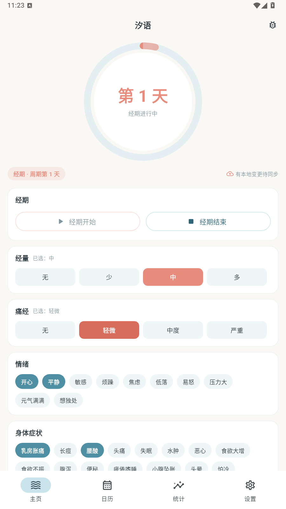
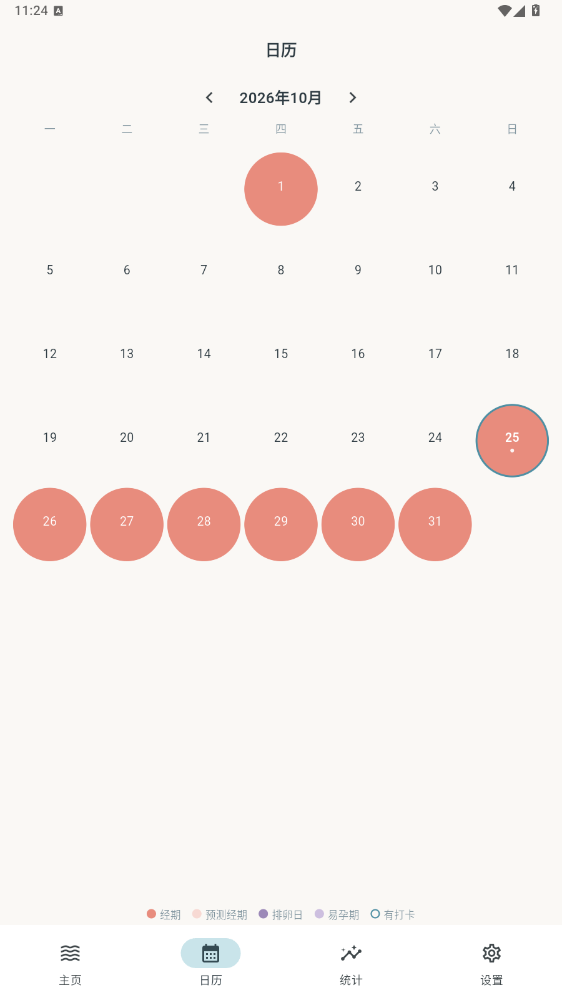
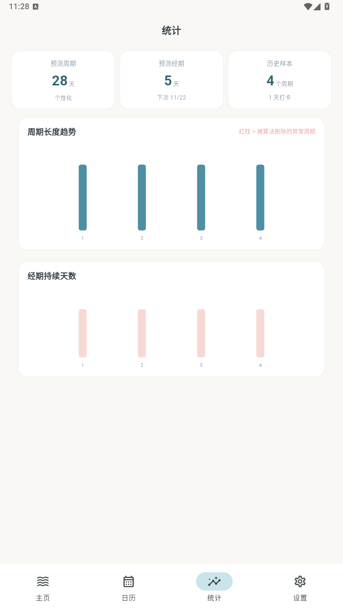
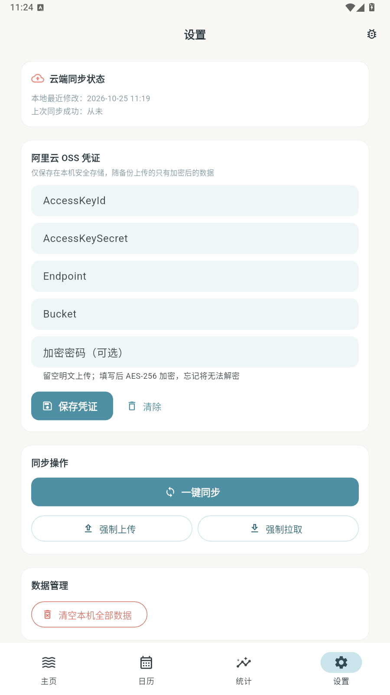

<div align="center">

# 🌊 汐语 TideLog

**聆听身体的潮汐 · 一款纯私有的经期与健康管理 App**

纯私有 · 零广告 · 单用户 · 数据只属于你自己


*主页 · 倒计时圆环与快捷打卡*

</div>

---

## ✨ 这是什么

**汐语 (TideLog)** 把身体的周期起伏比作自然的潮汐——顺应生活节奏，聆听身体的声音。

它是一款给你自己（或你爱的人）用的经期管理 App，对标美柚的核心打卡体验，
但彻底剥离了那些让你厌烦的东西：

| 市面上的经期 App | 汐语 |
|---|---|
| 开屏广告、弹窗、push 轰炸 | ☑️ 零广告、零推送、零打扰 |
| 社区、电商、会员商城 | ☑️ 只做一件事：安静地记录周期 |
| 第三方埋点 SDK 满天飞 | ☑️ 没有自己的服务器，没有统计埋点 |
| 数据存在别人的云上 | ☑️ 数据只在本机 + **你自己的**阿里云 OSS |
| 复杂的账号体系 | ☑️ 无需注册，打开即用 |

## 📸 界面预览

| 主页 | 日历 |
|---|---|
|  |  |
| **统计** | **设置** |
|  |  |

## 🌊 功能特性

### 🏠 主页 — 倒计时圆环 + 快捷打卡
- 潮汐渐变圆环：经期中显示珊瑚色进度弧与「经期第 N 天」，平时显示距下次经期的天数
- 当前阶段徽章：经期 / 预测经期 / 排卵日 / 易孕期 / 安全期
- 云端同步状态灯：未配置 / 已同步 / 有本地变更待同步
- 快捷多维打卡（对齐美柚维度）：经量（无/少/中/多）、痛经（四级）、10 种情绪标签、15 种身体症状、同房记录——**再点一次即可取消，全部清空自动删除空记录**

### 📅 日历 — 多色月历
- 五色语义标注：**实际经期**（珊瑚）、**预测经期**（浅珊瑚）、**排卵日**（雾紫）、**易孕期**（浅紫）、**有打卡**（蓝点）
- 月份切换 + 今日高亮环，点按任意日期查看当日打卡详情
- **历史补录（v1.1.1）**：点按任意过去日期即可「这天开始经期 / 在这天结束 / 补录整段经期」——刚下载的用户一次导入数月历史，预测算法从第一天起就有数据可用

### 📊 统计 — 周期洞察
- 三张核心卡片：预测周期（含数据成熟度）、预测经期、历史样本数
- 周期长度趋势柱状图，**被算法剔除的异常周期标红**——算法在替你过滤噪声，也让你看见它过滤了什么
- 经期持续天数趋势图

### ⚙️ 设置 — 一切尽在掌控
- 阿里云 OSS 凭证管理（保存于系统安全存储）
- 一键同步 / 强制上传 / 强制拉取，同步状态一目了然
- 危险区：一键清空本机数据（云端备份不受影响）

## 🧮 经期预测算法

`PeriodCalculator` 是一个**纯函数**算法类，针对真实世界的脏数据做了完整处理：

| 场景 | 策略 |
|---|---|
| **冷启动** | 无数据时默认 28 天周期 / 5 天经期；仅 1-2 个周期样本时以实际观测为「临时基准」 |
| **个性化** | ≥3 个有效样本后，取最近 6 个周期做**加权移动平均**——越近的周期权重越高 |
| **异常值过滤** | 周期 <15 天（误记/点滴出血）或 >60 天（漏记/疾病）不参与平均，但保留展示让你知道它剔除了什么 |
| **排卵推算** | 排卵日 = 下次预测经期开始日 − 14 天；易孕期 = 排卵日前 5 后 4 共 10 天；其余为安全期 |
| **预测滚动** | 上次经期离今久远时，预测自动向前滚动到今天或之后，永不显示「过期预测」 |
| **进行中经期** | 未结束的经期最多向后覆盖 14 天，不会吞掉未来所有日期的归属判断 |

## 🔐 隐私与安全架构

```
本机 Isar 数据库 ──AES-256-CBC 加密──▶ 你的阿里云 OSS 私有桶
       ▲                                    │
       └────────── 时间戳裁决 · 整体覆盖 ◀──┘
```

- **凭证安全**：AccessKeyId / Secret / 加密密码只存 `flutter_secure_storage`（Android Keystore / iOS Keychain），代码中零硬编码
- **传输加密**：备份文件经 AES-256-CBC 加密（口令 SHA-256 派生密钥 + 随机 IV，密文带 `TIDELOG-AES1:` 魔数头）
- **签名直传**：OSS RESTful V1 签名（HMAC-SHA1）从手机直传你的桶，没有中间服务器
- **极简同步**：单用户无需分布式冲突解决——比较本地与云端的 `dataUpdatedAt` 时间戳，新的一方整体覆盖旧的一方，相等则零操作
- **恢复保真**：从云端恢复时 id 与时间戳原样保留，恢复后两端立即视为已同步

## 🏗️ 技术架构

| 层 | 技术 |
|---|---|
| 框架 | Flutter 3.47 (Dart 3.13)，Material 3，全局竖屏锁定 |
| 本地存储 | [isar_community](https://github.com/isar-community/isar-community) 3.4.1（原版 isar 已停维护，社区分支与新版 Dart 兼容，API 一致） |
| 状态管理 | provider + `ChangeNotifier`（订阅数据库变更流，任何写入自动刷新 UI） |
| 安全存储 | flutter_secure_storage |
| 图表 | fl_chart |
| 网络 | dio（OSS V1 签名直传）+ encrypt（AES-256）+ crypto（SHA-256/HMAC） |

```
lib/
├── main.dart               # 应用入口 + 底部导航壳
├── core/                   # 主题（潮汐色系）、常量、日历日期工具
├── models/                 # PeriodRecord / DailyLog / SyncMeta + 标签字典
├── services/               # 数据库服务、三仓储、OSS 配置/客户端/加密/同步
├── algorithms/             # PeriodCalculator 经期预测
├── providers/              # AppDataProvider 全局状态层
└── views/
    ├── home/               # 倒计时圆环 + 快捷打卡
    ├── calendar/           # 多色月历
    ├── analytics/          # 统计图表
    ├── settings/           # 凭证与同步管理
    └── debug/              # 🐛 仅 debug 构建可见的调试面板
```

**数据模型**（全部带 `createdAt` / `updatedAt` 时间戳，适配整体覆盖同步）：
- `PeriodRecord` — 一次经期事件（开始/结束/来源）
- `DailyLog` — 每日打卡（`date` 唯一索引，一天一条；`null` 语义为「未记录」，区别于「记录了但没有」）
- `SyncMeta` — 同步元数据单例（本地变更时间戳 / 上次同步时刻）

## 🚀 快速开始

### 环境要求
- Flutter 3.24+（开发环境为 3.47，Dart 3.13）
- Android Studio / Xcode 各自的平台工具链
- JDK 17

### 构建运行

```bash
git clone <your-repo-url>
cd TideLog/tide_log

# 获取依赖（国内网络建议先配置 Flutter 镜像，项目已内置 Gradle 国内镜像）
flutter pub get

# Isar 代码生成（首次或修改模型后）
dart run build_runner build --delete-conflicting-outputs

# 运行
flutter run
```

> 💡 **国内网络提示**：项目已在 `android/gradle/wrapper/gradle-wrapper.properties`
> 与 `android/settings.gradle.kts` 中内置腾讯云/阿里云镜像，克隆即可直接构建。

### 运行测试

```bash
flutter test   # 52 个用例：数据层 / 预测算法 / 加密与同步全链路 / UI 冒烟
```

> 首次运行宿主测试需要 Isar 原生库：仓库已内置 Windows DLL
> （`test/native/`），其他平台会自动下载。

## ☁️ 配置你的阿里云 OSS

1. 在 [OSS 控制台](https://oss.console.aliyun.com/) 创建一个 Bucket，**读写权限设为私有**
2. 在 [RAM 控制台](https://ram.console.aliyun.com/) 创建用户，授予 `AliyunOSSFullAccess`，生成 AccessKey
3. 打开汐语 → 设置 → 阿里云 OSS 凭证，填入 AK / SK / Endpoint / Bucket
4. （推荐）设置一个**加密密码**——忘记它将无法解密云端备份，请务必牢记
5. 点击「一键同步」，完成第一次备份 🎉

## 🌐 分发落地页

[`landing/index.html`](landing/index.html) 是一个零依赖的极简静态下载页（品牌展示 + APK 下载 + iOS 侧载指引 + 隐私承诺），可直接托管：

```bash
# 方式一：阿里云 OSS 静态网站托管（与备份同一家云）
# 方式二：GitHub Pages —— 将 landing/ 目录发布为 Pages 站点即可
```

发布 App 时把签名后的 APK 复制到 `landing/tide_log.apk` 即可让下载按钮生效。

## 🗺️ Roadmap

- [ ] OSS 真实凭证实测（多端同步闭环验证）
- [ ] release 签名构建流水线与版本发布
- [ ] iOS 侧载指引实测（AltStore / TestFlight）
- [ ] 备份数据导出为可读文件（JSON / CSV）
- [ ] 桌面小组件 / 月经备忘提醒

## ⚠️ 免责声明

汐语的经期预测基于历史数据的统计学推算，**仅供参考**，不构成任何医疗建议，
**不能作为避孕或备孕的医学依据**。如有健康疑虑，请咨询专业医生。

## 🤝 致谢

- 感谢 [isar-community](https://github.com/isar-community/isar-community) 接管维护了优秀的 Isar 数据库
- 感谢美柚等前辈产品打磨出的经期打卡维度范式
- 本项目由 ZCode 与 GLM 大模型协作开发——从项目初始化到四页 UI，五步走完，全程人机结对

## 📄 License

MIT © 2026 TideLog Contributors

---

<div align="center">
<sub>愿每一次潮汐起伏，都被温柔记录。🌊</sub>
</div>
